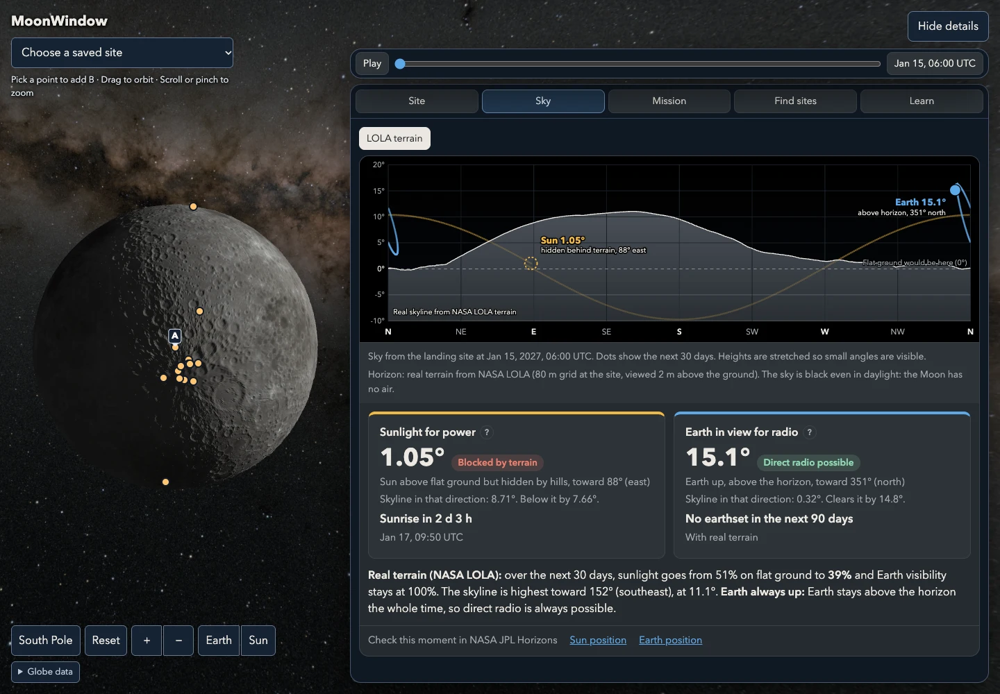
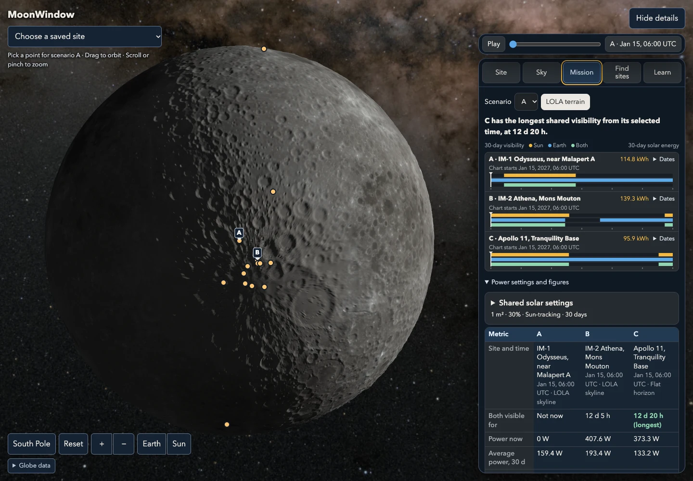

# MoonWindow

**Open `index.html` in a modern browser and start exploring.** MoonWindow runs entirely offline from one self-contained file (about 14 MB), with the terrain, imagery, and code already bundled. Setup takes one step.

**Click the Moon, choose a date, and see what changes.** Use the side panel to analyze the site. The globe and timeline show when sunlight and a direct line of sight to Earth are available. Compare up to three landing sites side by side, each with its own start date.

NASA Space Apps Challenge 2026 project for the lunar landing site challenge (Sun and Earth visibility at the Moon's south pole).

## What it does

### Explore the 3D Moon and pick a site

Drag to orbit, scroll or pinch to zoom, and use **South Pole** or **Reset** to reorient the view. The WebGL globe uses NASA LOLA elevation and LROC imagery. At the selected UTC time, MoonWindow projects the calculated Moon-relative positions of the **Sun** and **Earth** into the scene and uses the Sun’s direction to light the Moon. The **Sun** and **Earth** buttons turn the view toward each body. The globe enlarges their rendered disks for readability.

Choose a saved landmark from the globe dropdown, click its pin, enter precise coordinates in **Site**, or click the lunar surface. A surface click fills the next available scenario up to A, B, and C. With all three slots filled, it moves the selected scenario. Use **Copy link** to share the site and time for each scenario.

### See the local skyline and solar and Earth tracks

**Sky** is a 360° SVG chart from the selected landing site. Azimuth runs left to right and elevation runs vertically. The chart overlays the Sun and Earth’s current positions and their **next 30 days of tracks** on the NASA LOLA skyline, including ridges and crater rims. Switch between **LOLA terrain** and **Flat horizon** to see what the local terrain blocks. The cards show each body’s direction, clearance above or below the skyline, and time until the next rise or set when one is found. They also link to NASA JPL Horizons for the selected site and time.

Choose a historical or future UTC date to see the modeled Sun and Earth positions for that moment. The tracks extend 30 days forward from the selected time. At your chosen site, follow where each track clears or drops below the skyline, then scrub through time to check when both bodies are valid qualifying times. **Mission → Dates** can also search for starts that meet your required duration of continuous shared visibility.



### Plan dates, compare sites, and estimate solar power

**Mission** puts up to three site-and-date scenarios side by side. Each 30-day timeline shows when the **Sun**, **Earth**, and **both together** clear the horizon. Drag a track or use the shared UTC scrubber above the sidebar. You can also enter a date, step by an hour, day or week, jump to **Now**, or press **Play**. The globe and analysis update as time changes.

Set **Mission days** to see whether each scenario has continuous sunlight and direct Earth line of sight for long enough. Mission tests each chosen UTC start and the same site one week later. Open **Dates** to search the next year, order qualifying windows by earliest start or longest overlap, and jump to a result. **Export CSV** saves the sites, times, window checks, visibility assumptions, and numeric power estimates.

Open **Power settings and figures** to compare power now and average power in watts, total solar energy in kWh, and shared visibility. All scenarios use the same panel area, efficiency, fixed or Sun-tracking vertical mount, and mission duration. The Sun rule can require any visible part of the disk, its centre, or the entire disk for visibility windows. Solar estimates use the visible fraction in all three modes and omit dust, temperature and equipment shadow losses. Earth visibility represents geometric line of sight.



### Find candidate sites and try the learning challenges

**Find sites** searches the south-pole grid or the archived Artemis candidate regions. Filter by slope and minimum Sun and Earth coverage. Rank by sunlight, Earth visibility, overlap, or slope, then shortlist up to three spaced-apart points. Check for joint visibility at the selected time and after a one-week delay. Send two or three picks to Mission at one common time or at their earliest qualifying starts. [Finder method and demo](#best-landing-spots-in-nasas-artemis-iii-regions)

**Learn** uses scenario A for three hands-on challenges. Find a time when IM-2 has both sunlight and Earth in view, identify a far-side landing site with no direct Earth view, or find when IM-1 is shaded by its crater wall. **Check my answer** gives a ✓ or ✕ and explains correct answers.

## How to run it

Open `index.html` in any modern browser. That's it: there's no server, nothing to install, and it works offline.

A fresh open goes straight to the **Mons Mouton seven-day decision**. The January 15 start passes. A one-week slip leaves it **6 h 39 min short** because sunlight ends before the mission does. **Show why** opens Sky at that crossing and highlights the limiting body. **Find next qualifying start** searches from the slipped date using the same duration and visibility assumptions. To open this exact scenario from a published copy, append `#s=-84.1652,28.9528,20270115T0600&days=7&view=mission` to the app URL.

To publish it on GitHub Pages: repository **Settings → Pages → Build and deployment → Deploy from a branch → `main` / root → Save**. After a minute the site is live at `https://<user>.github.io/<repo>/`.

## How it works

For each moment, the app:

1. Gets the positions of the Sun, Earth and Moon from [Astronomy Engine](https://github.com/cosinekitty/astronomy) (MIT License).
2. Turns the Moon to its orientation from the IAU/WGCCRE 2009 rotation model. That's the mean Earth/polar axis frame used by LRO, LOLA and LROC coordinates.
3. Works out the direction from the landing site to the Sun and to Earth as **elevation** (degrees above the ideal flat horizon) and **azimuth** (degrees from north toward east).
4. Compares the elevation with the skyline in that direction: real LOLA terrain at the south polar sites, flat ground elsewhere.

Timelines use one-hour steps, and countdowns are refined to one minute by bisection.

Sanity checks we ran:

| Case | Expected | MoonWindow |
| --- | --- | --- |
| Apollo 11 landing, 1969-07-20 20:17 UTC | Sun low in the east (~11°) | Sun 10.7° at az 89° |
| Chandrayaan-3 landing, 2023-08-23 12:33 UTC | Sun low after sunrise | Sun 8.6° |
| Chang'e 6 (far side) | Earth never visible | Earth −42.7° |
| Apollo 11, 2020–2039 | Earth always high, swinging with libration | Earth 57.7° to 74.5° |

### Validation against NASA JPL Horizons

Across 72 comparisons (9 sites × 4 dates × Sun and Earth), the app matches NASA JPL Horizons within **0.003° in elevation** and 0.005° in azimuth, with identical up/down status in all 72 cases. Full table: [docs/validation.md](docs/validation.md). Re-run with `python3 tools/fetch_horizons.py` (needs internet) and then `node tools/compare_horizons.js`.

### Terrain validation and how to check it in Sky

**Does terrain change a seven-day landing decision?** We screened 1,600 historical site/start combinations and checked approved starts against LRO camera observations. With a flat horizon, **150 of 217** approved starts had an observed shadow. With the LOLA skyline and the same Sun-centre rule, **zero of 34** approved starts had an observed shadow. The cameras sample at intervals, so they can reveal a false pass while leaving gaps between observations. [Seven-day study and in-app replay](docs/lroc-mission-window-validation.md)

MoonWindow tests its terrain-based sunlight predictions against images from NASA’s Lunar Reconnaissance Orbiter Camera (LROC). We used **309 camera frames** to bracket **52 observed sunrise and sunset events** near the south pole. With the default Sun-centre rule, the LOLA terrain model predicted **11 of 52** transitions inside their observed intervals, compared with **1 of 52** for a flat horizon. Counting the first or last visible edge of the Sun reached **32 of 52**. The camera cadence bounds when the change happened to an interval. [Observational study, sunrise figure, and reproduction steps](docs/lroc-transition-validation.md)

**Try the terrain check in Sky**

1. Choose **IM-1 Odysseus** from the saved-site dropdown and set the UTC time to **January 15, 2027, 06:00**.
2. Open **Sky** and switch the horizon toggle to **Flat horizon**. The Sun is **1.05° above** the 0° line, toward the east, so it clears a flat horizon.
3. Switch back to **LOLA terrain**. The skyline in that direction rises to **8.71°**, placing the Sun below the modeled crater rim. The Sun card reports the obstruction and the chart shows the Sun and Earth tracks against the local skyline. Scrub the time to watch the tracks cross the skyline.

Sky lets you inspect why a particular prediction changes with terrain. The LROC study checks the predicted timing against spacecraft observations at other south-pole locations. To try the disk-edge rule used in that study, go to **Mission → Power settings and figures** and choose **Any visible part** under the sunlight rule.

## Real terrain from NASA LOLA

`tools/make_horizons.py` reads two LOLA south polar elevation models from the NASA GSFC Planetary Geodesy Data Archive (Barker et al. 2023, *Planetary Science Journal* 4:183, doi:10.60903/gsfcpgda-lola-spole):
- **LDEM_80S_80MPP_ADJ**: 80 m grid, 80°S to the pole, used wherever it covers the ground.
- **LDEM_60S_240MPP_ADJ**: 240 m grid, 60°S to the pole, used beyond that.

For each south polar site and every 0.5° of azimuth, the tool traces 400 km outward over the curved Moon (radius 1737.4 km). It records the highest terrain angle seen from 2 m above the ground, the approach of NASA's LOLA polar illumination maps (Mazarico et al. 2011, *Icarus* 211). The result is `src/horizon-data.js`. The same run makes `src/map-data.js`, a shaded-relief map of 75°S to the pole.

Checks:
- **Map reading:** both maps give 2,592 m at IM-1 Odysseus's landing point; LROC reports 2,579 m.

**Why location matters:** we found the ridge's best-lit point by testing the 40 highest 80 m pixels within 1.5 km. Their yearly sunlight ranges from **57.5% to 88.3%**. The app includes a second ridge site only 200 m from the best one, which gets 77.5%.

Yearly results (`node tools/terrain_report.js`, also in [docs/terrain-report.md](docs/terrain-report.md)):

| Site (1 year from Nov 2026) | Map at site | Sunlight, real terrain | Sunlight, flat ground | Earth in view | Both | Longest night |
| --- | ---: | ---: | ---: | ---: | ---: | ---: |
| Connecting ridge, best-lit point | 80 m | 88.3% | 52.0% | 52.6% | 49.7% | 10.7 d |
| Connecting ridge, 200 m away | 80 m | 77.5% | 52.0% | 52.4% | 40.4% | 10.5 d |
| IM-2 Athena, Mons Mouton | 80 m | 46.3% | 51.6% | 81.3% | 38.4% | 19.1 d |
| IM-1 Odysseus | 80 m | 39.7% | 51.0% | 100% | 39.7% | 19.0 d |
| Chandrayaan-3 | 240 m | 49.4% | 51.5% | 100% | 49.4% | 16.0 d |

### Custom coordinates

Any point south of 77°S also gets real terrain, including custom coordinates and newly added sites. The same tool writes `src/terrain-grid.js`, which holds the 240 m LOLA heights from 84°S to the pole plus 960 m averages out to 75°S, compressed to 1.9 MB. `src/terrain.js` decodes it in the browser (about 0.5 s after load) and computes a skyline in a few milliseconds, with the same method as the Python tool. Unit test 13 checks the decoding and the result.

How accurate the 240 m skylines are depends on the ground:
- **Plains and plateaus:** they match the 80 m results closely. At IM-2, yearly sunlight is 46.4% from the grid against 46.3% from 80 m, and a custom point 2.6 km away gets 51% over 30 days, against 52% at the site.
- **Narrow ridge crests:** they are approximate. The Sun grazes the skyline there for about 2,100 hours a year, so tenths of a degree matter. At 240 m, the two ridge points even swap ranking compared with 80 m. The app says so for custom points.

A known check: 87.5°S 45°E, inside the permanently shadowed Shoemaker crater, gets 0% sunlight.

To regenerate, download the maps (not stored in git) and run the tools:

```
mkdir -p data
curl -L -o data/LDEM_60S_240MPP_ADJ.TIF https://pgda.gsfc.nasa.gov/data/LOLA_20mpp/LDEM_60S_240MPP_ADJ.TIF
curl -L -o data/LDEM_80S_80MPP_ADJ.TIF https://pgda.gsfc.nasa.gov/data/LOLA_20mpp/LDEM_80S_80MPP_ADJ.TIF
pip install numpy tifffile imagecodecs pillow
python3 tools/make_horizons.py && node tools/terrain_report.js && python3 build.py
```

## Best landing spots in NASA's Artemis III regions

The **Find sites** tab defaults to a **160 km radius** around the lunar south pole, sampling a 5 km grid and spacing shortlisted points at least 12 km apart. It can also search the original region picks and additional points on a 1 km grid within 5 km of each Artemis region reference coordinate, with a 2 km shortlist buffer. Sampled points use the bundled 240 m or 960 m LOLA terrain, and each result shows its resolution. Coverage filters use 2027 samples at two-hour intervals. After choosing up to three points, check the selected UTC time and a one-week delay for continuous Sun and Earth visibility, or load two or three picks into Mission. The window check samples hourly and searches the next year for the earliest qualifying start.

Use **Compare at selected time** for a common reference date, or **Compare earliest starts** after checking two or three picks that each have a qualifying window. Mission starts each chart at the time used for that scenario. The playhead shows the currently selected time as you scrub.

To regenerate the offline shortlist from the existing terrain assets, run `node tools/make_site_candidates.js > src/site-candidates.js` and then `python3 build.py`. The grid provides preliminary screening and can miss terrain between sampled points.

Demo example. Filter **Mons Mouton Plateau**, rank by **Most Sun and Earth together**, and set January 15, 2027 at 06:00 UTC. At 84.1652°S, 28.9528°E the hourly Finder gives **13 days 18 hours** of shared visibility from that time and **6 days 18 hours** from a week later. In **Mission**, set **Mission days** to **7**. Its more finely resolved crossings show **13 days 17 hours** at the selected start and **6 days 17 hours** after the slip. The original start meets the target and the delayed start falls short.

NASA's Artemis III candidate regions are each about 15 × 15 km; the lander needs a spot about 100 m across inside one. A single "region" coordinate can land on a steep slope or in shadow. The published coordinate for Slater Plain, for example, gets 4% sunlight over a year. So for each region, `tools/find_artemis_spots.py` searches the LOLA 80 m map within 5 km of the published coordinate and applies NASA's landing rules ([Artemis HLS Overview, Space Apps 2025](https://ntrs.nasa.gov/citations/20250009323)):

1. Every point on a 100 m grid (7,845 per region) gets its ground slope across a 100 m-radius site, from a plane fitted to the terrain. Points at 9° or steeper are dropped: NASA's limit is 10°, and an 80 m map smooths small bumps, so we keep a margin.
2. Each remaining point gets a fast skyline and a year of Sun and Earth positions (2027, every 2 hours). Points with Earth in view less than 25% of the time are dropped.
3. The 25 sunniest points that remain (at least 300 m apart) get the full skyline the app uses. The sunniest of those becomes the site.

| Region | Published coordinate | Slope | Sun / Earth (year) | Best spot | Distance | Slope | Sun / Earth (year) |
| --- | --- | ---: | ---: | --- | ---: | ---: | ---: |
| Peak near Cabeus B | -83.661, 290.986 | 14.1° | 30% / 0% | -83.6181, 291.4089 | 1.93 km | 6.0° | 70% / 60% |
| Haworth | -86.753, 337.164 | 5.6° | 11% / 36% | -86.9157, 337.0866 | 4.94 km | 1.9° | 58% / 59% |
| Malapert Massif | -85.99, 359.875 | 6.3° | 44% / 54% | -86.0006, 2.0475 | 4.62 km | 7.0° | 80% / 54% |
| Mons Mouton Plateau | -84.232, 29.926 | 18.4° | 37% / 100% | -84.2419, 29.1536 | 2.38 km | 2.3° | 52% / 100% |
| Mons Mouton | -85.423, 31.586 | 8.8° | 40% / 67% | -85.4116, 31.7397 | 0.51 km | 2.9° | 78% / 63% |
| Nobile Rim 1 | -85.431, 37.241 | 14.2° | 28% / 33% | -85.3066, 37.0461 | 3.81 km | 5.1° | 83% / 53% |
| Nobile Rim 2 | -83.963, 58.654 | 6.9° | 38% / 62% | -84.0652, 59.242 | 3.62 km | 1.5° | 52% / 73% |
| de Gerlache Rim 2 | -88.225, 294.579 | 8.8° | 36% / 50% | -88.287, 289.5575 | 5.0 km | 6.9° | 54% / 56% |
| Slater Plain | -87.149, 126.134 | 6.5° | 4% / 37% | -87.2813, 127.9327 | 4.81 km | 1.3° | 66% / 43% |

The region coordinates come from Table 4 of [this preprint](https://www.preprints.org/manuscript/202511.1488) (`tools/artemis_regions.json`). We checked them against the centers of LROC's official mosaics of the Artemis III candidate sites ([LROC NAC ROI products](https://data.lroc.im-ldi.com/lroc/view_rdr/NAC_ROI_CABEUSPKLO2)). Peak near Cabeus B, Haworth, Malapert Massif, Mons Mouton Plateau and Nobile Rim 2 all match within 3 km, which is about the rounding of LROC's 0.1° centers. LROC also shows that Peak near Cabeus B (83.6°S) and Nobile Rim 2 (83.9°S) lie more than 6° from the pole. NASA's 6° rule comes from its 2022 announcement, so the app's pole check uses the reach of the 2024 regions instead (6.4°).

**Checking the slope method against a real landing:** NASA estimated from LRO images that IM-1 Odysseus came to rest on a 12° slope, and the lander tipped over. Our LOLA slope at the IM-1 site is 11.6°. The app shows it failing NASA's 10° rule.

## Limitations

- **Terrain detail.** The 80 m and 240 m grids capture mountains, ridges and crater rims, not boulders or small craters next to the lander. Points north of 77°S that are not listed sites use flat ground.
- **Centre of the disk.** "Up" means the centre of the Sun or Earth is above the horizon.
- **Hourly sampling** for the 30-day statistics.

## Landing site sources

| Site | Lat | E-lon | Source |
| --- | --- | --- | --- |
| IM-2 Athena, Mons Mouton | −84.79 | 29.20 | IM-2 records based on LROC ([LROC landing region](https://www.lroc.asu.edu/images/1401)) |
| IM-1 Odysseus | −80.13 | 1.44 | [LROC](https://www.lroc.asu.edu/images/1360) |
| Connecting ridge near Shackleton, best-lit point | −89.4393 | 222.733 | Best-lit of the 40 highest LOLA 80 m points within 1.5 km of the ridge crest. The crest was first located from the high-illumination point at 89.45°S 229.69°E given by [the-moon.us](https://the-moon.us/wiki/South_Pole), which sat about 500 m below it. |
| Connecting ridge, 200 m from the best-lit point | −89.4458 | 222.706 | Highest point on the 240 m map, kept to show how much 200 m matters. |
| Chandrayaan-3, Statio Shiv Shakti | −69.373 | 32.319 | [USGS Gazetteer](https://planetarynames.wr.usgs.gov/Feature/16272) |
| Chang'e 6 | −41.6385 | 206.0148 | [LROC](https://lroc.im-ldi.com/images/1374) |
| SLIM | −13.316 | 25.251 | [NASA NSSDC](https://nssdc.gsfc.nasa.gov/planetary/lunar/lunar_artifact_impacts.html) |
| Blue Ghost 1 | 18.56 | 61.81 | [LROC](https://www.lroc.im-ldi.com/images/1400) |
| Apollo 11 | 0.674 | 23.473 | NASA NSSDC |

## NASA data and resources

- **LRO LOLA topography** (NASA GSFC PGDA): real skylines for the south polar sites, which change sunrise, sunset, Earthrise, Earthset and all statistics, plus the polar map.
- **JPL Horizons:** reference positions; the app matches them within 0.003°. Each scenario also links to the same Horizons query.
- **LROC (Lunar Reconnaissance Orbiter Camera) and QuickMap:** landing site coordinates.
- **NASA NSSDC:** Apollo 11 and SLIM coordinates.

## Files

- `index.html` is the complete app in one file, generated by `build.py`. Don't edit it by hand. GitHub Pages serves this file.
- `src/index.html` holds the layout and CSS, plus one `<script src>` line per file.
- `src/app.js` is the core UI. `src/engine.js` computes Sun and Earth positions. `src/terrain.js` computes skylines from the LOLA grids. `src/sites.js` is the landing site list.
- `src/plugins/` holds the extra features, one file each; `_template.js` shows the plugin API.
- `src/horizon-data.js`, `src/map-data.js`, `src/terrain-grid.js` and `src/validation-data.js` are generated NASA data. Don't edit them by hand; see the `tools/` scripts.
- `tools/` holds `fetch_horizons.py` and `compare_horizons.js` (JPL Horizons validation), `make_horizons.py` (LOLA terrain and slopes), and `artemis_series.js` + `find_artemis_spots.py` (best Artemis III landing spots; results in `artemis_spots.json`). `docs/validation.md` is the validation table.
- `data/` is the local LOLA elevation model download; it's not in git.
- `build.py` inlines every `<script src>` into `index.html`. Run `npm install` once, then `python3 build.py`.

## AI use

The code in this repository (HTML, CSS, JavaScript and the build script) was generated with an AI assistant (Claude by Anthropic and Codex by OpenAI) from requirements written by our team. The team chose the problem framing, landing sites and features, reviewed and tested the results, and validated them against NASA JPL Horizons. No AI-generated images, video or audio are used.

## Credits and licenses

- Astronomy Engine © 2019–2023 Don Cross, MIT License (notice kept inside `index.html`).
- Not an official NASA product. No NASA logos or insignia are used.
