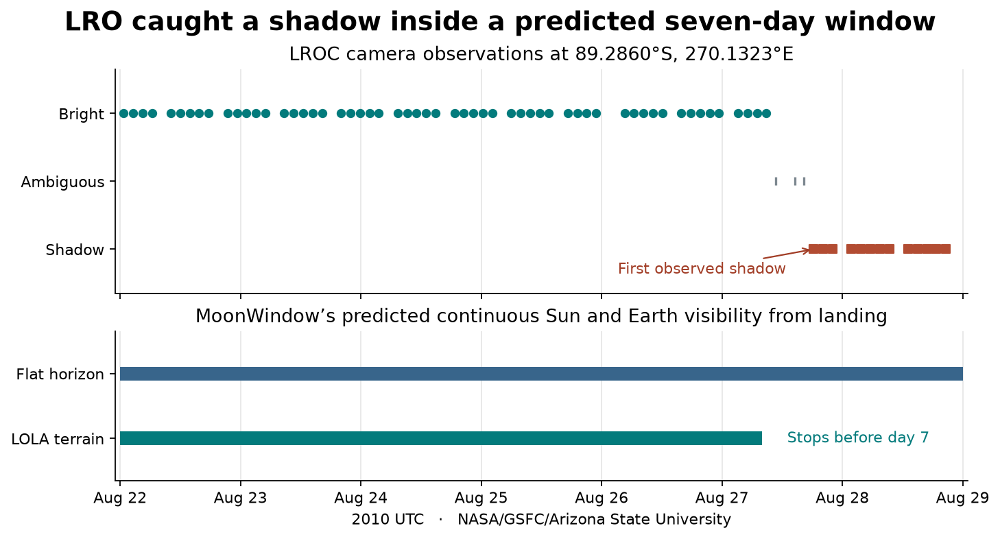

# Can a spacecraft image overturn a seven-day landing recommendation?

MoonWindow screened **1,600 seven-day landing starts at 100 south-polar sites** for continuous Sun and Earth visibility. Then we asked a question the camera can answer directly. **Was the site observed in shadow during a window the model approved?** Using the default Sun-centre rule, the flat-horizon planner approved 217 starts and LRO observations contradicted **150** of them. The terrain-aware planner approved 34 starts and none contained a confidently dark observation in this sample. [LROC South Pole Movie archive](https://data.lroc.im-ldi.com/lroc/view_rdr/WAC_POLE_MOVIE_SOUTH) · [Speyerer and Robinson (2013)](https://doi.org/10.1016/j.icarus.2012.10.010)

| Model | Seven-day starts approved | Approved starts with observed darkness | Approved starts with darkness using stricter image cutoff |
| --- | ---: | ---: | ---: |
| Flat horizon, Sun centre | 217 | 150 | 129 |
| LOLA skyline, Sun centre | 34 | 0 | 0 |
| Flat horizon, any visible part of Sun | 219 | 152 | 131 |
| LOLA skyline, any visible part of Sun | 43 | 0 | 0 |

The default flat-horizon contradictions span **74 distinct sites**. The 34 terrain approvals span **20 sites**. Restricting the comparison to seven-day windows with no camera gap longer than eight hours gives **117 contradictions in 162** flat-horizon approvals and **zero in 34** terrain approvals. This check used the same fixed duration, sites, and start times; the horizon and solar-disk rule are the only model differences.

## A landing decision you can replay

At **89.2860°S, 270.1323°E**, start a seven-day mission on **August 22, 2010 at 00:00 UTC**. In the offline app, **Flat horizon** gives **12 days 21 hours** of continuous Sun and Earth visibility. Switch to **LOLA terrain** and the modeled overlap falls to **5 days 8 hours**. LRO recorded **13 dark observations** inside the proposed seven-day window, including six that pass the stricter darkness cutoff. The first dark frame began at **18:12 UTC on August 27**. [First dark LROC frame](https://data.lroc.im-ldi.com/lroc/view_rdr_product/WAC_MOVIE_S20100827T1812)



To open the replay from a published copy, append `#s=-89.2860,270.1323,20100822T0000&days=7&terrain=flat&view=mission` to the app URL, then turn on LOLA terrain.

## Method and scope

1. Reuse the 309 archived 100 m/pixel frames, 100 fixed site coordinates, and image labels from the [separate transition-timing study](lroc-transition-validation.md). At each site, test every midnight UTC start for which seven full calendar days fit within the February 15–28 or August 15–28 observation period. That gives eight starts per period and 16 starts per site.
2. Use MoonWindow’s `findWindows` landing-date search, astronomy engine, and bundled custom-site terrain profiles. A pass requires the hourly search to return seven continuous days of Sun and Earth visibility from the selected start. The planner is held fixed across the four conditions. The replay uses the Mission panel's minute-refined crossing.
3. Retain observations whose entire acquisition fits within a window. Mark a dark patch if at least seven of its nine pixels have values at or below 0.0005. The stricter cutoff is 0.00035. A dark frame contradicts a continuous sunlight claim under the study’s image labels. The maximum camera gap includes gaps between frames and at both edges of the window.

These starts overlap and share camera frames, so the totals are descriptive counts. Gaps in observations and ambiguous brightness leave room for missed shadow events. The test can challenge a joint recommendation via observed darkness. It does not verify Earth visibility, guarantee sunlight between images, or measure delivered panel power. The observations come from the existing LROC sample and this check evaluates a different outcome.

## Reproduce

```sh
npm ci
node tools/check_lroc_mission_windows.js > lroc-mission-window-results.csv
```

The runner uses the cached NASA image measurements offline and prints the aggregate counts to stderr. The [1,600-window results](lroc-mission-window-results.csv) list the coordinates, UTC start, frame counts, first dark image ID, largest camera gap, and the decision under all four visibility models.
