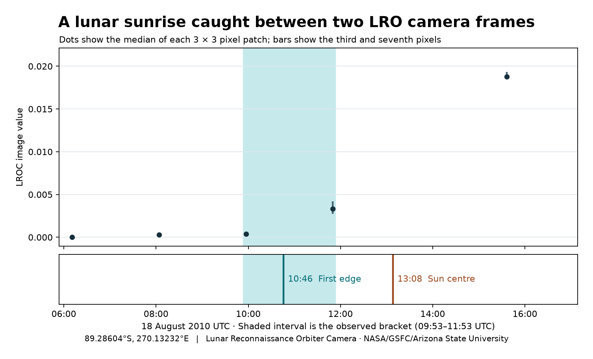

# Do predicted sunrise and sunset times match lunar camera observations?

We checked MoonWindow’s sunlight predictions against **309 real Lunar Reconnaissance Orbiter Camera (LROC) frames** at 100 locations near the lunar south pole. The images give **52 sunrise or sunset intervals**, each bounded by a dark and a bright observation no more than four hours apart. The current terrain model put **11 of 52** crossings inside those intervals, versus **1 of 52** with a flat horizon. Using the first visible edge of the solar disk with the same terrain put **32 of 52** inside. [Source image archive](https://data.lroc.im-ldi.com/lroc/view_rdr/WAC_POLE_MOVIE_SOUTH) · [Speyerer and Robinson (2013)](https://doi.org/10.1016/j.icarus.2012.10.010)

## Results

| Model | Balanced light/dark accuracy | Predicted crossing inside image interval | Within two hours of interval |
| --- | ---: | ---: | ---: |
| Flat horizon, Sun centre | 77.3% | 1 / 52 | 1 / 52 |
| Flat horizon, first or last visible edge | 74.0% | 0 / 52 | 1 / 52 |
| LOLA terrain, Sun centre (current Mission rule) | 96.8% | 11 / 52 | 31 / 52 |
| LOLA terrain, first or last visible edge (tested variant) | 98.3% | 32 / 52 | 49 / 52 |

The current rule correctly classifies **19,338 of 19,343** confidently dark patches and **5,778 of 6,172** confidently bright patches. Of the 32 centre-rule crossings found near the interval but outside it, all 15 sunrises are late and all 17 sunsets are early. That pattern is consistent with partial sunlight reaching the surface before the Sun’s centre clears the skyline and persisting after the centre drops below it.

The disk-edge variant improves interval hits in February (7/42 to 26/42) and August (4/10 to 6/10). With stricter camera thresholds, 31 intervals remain and the same comparison improves from 9/31 to 23/31. These are two observing periods at the same locations.

## A sunrise judges can check

On **18 August 2010** at **89.28604°S, 270.13232°E**, the camera saw shadow followed by light between **09:53 and 11:53 UTC**. The disk-edge model puts first direct sunlight at **10:46 UTC**. MoonWindow’s centre rule crosses at **13:08 UTC**. The flat-horizon model has no corresponding crossing within 24 hours of the interval. [Shadow frame](https://data.lroc.im-ldi.com/lroc/view_rdr_product/WAC_MOVIE_S20100818T0953) · [Sunlit frame](https://data.lroc.im-ldi.com/lroc/view_rdr_product/WAC_MOVIE_S20100818T1146)



This matters for planning because first direct light and usable solar power are different thresholds. A camera can see illuminated terrain when only part of the disk is visible. Available power also depends on panel orientation and how much of the disk is exposed. The timing experiment evaluates the sunlight side of the challenge. Direct-to-Earth communications and electrical output require separate evidence.

## Method

1. Take all catalog frames dated February 15–28 or August 15–28, 2010 UTC. Sample 25 equally spaced positions along each of four fixed rows of the map-projected 100 m/pixel images. Use native PDS image values and acquisition times. This gives 30,054 valid site-by-frame samples across 100 locations. Pixel coordinates are converted using the labels’ south-polar stereographic projection.
2. Use the nine valid pixels in each 3 × 3 patch. Label the patch bright when at least seven values are at least 0.002, or dark when at least seven values are at most 0.0005. Values between those categories are ambiguous. The cutoffs are analysis choices based on the image-value distribution. The stricter check uses 0.003 and 0.00035, respectively. The main labels retain 25,515 samples. Balanced accuracy averages the fraction of bright cases and the fraction of dark cases the model classifies correctly.
3. For each location and period, compare successive confidently classified observations. A change from bright to dark or dark to bright yields an interval from the earlier frame’s acquisition start to the later frame’s acquisition stop, including any intervening ambiguous frame. Keep intervals at most four hours wide. The median accepted interval is 232.5 minutes. Report whether the nearest same-direction model transition is inside the interval, within two hours of either endpoint, or missing within 24 hours. These hit counts measure success on observed events. The test does not score extra model events during gaps in camera coverage.
4. Use MoonWindow’s astronomy engine and its shipped, 240 m local LOLA skyline for all locations, with a 2 m observer and the app’s hourly search and one-minute refinement. Score the Sun-centre and solar-disk-edge rules against both terrain and flat horizons. Flat and terrain use the same ephemeris and sample times.

Image brightness is a proxy for illumination. Scattered light, shallow incidence, terrain model resolution, and the difference between a surface patch and a 2 m observer can all affect the comparison. Nearby patches and repeated frames are correlated. The counts describe this sample. The resulting intervals do not resolve the exact crossing minute.

## Reproduce

```sh
npm ci
node tools/compare_lroc_transitions.js > lroc-transition-results.csv
```

The Node script reads the [cached observation values](../tools/lroc-observations.csv.gz) offline and prints aggregate metrics to stderr. The [recorded event table](lroc-transition-results.csv) lists the original product IDs, coordinates, interval endpoints, predictions, and timing residuals. Camera values can be re-extracted with `python3 tools/sample_lroc_frames.py > lroc-observations.csv` using NASA's public PDS archive. To redraw the figure, use Python with Matplotlib and run `python3 tools/plot_lroc_example.py tools/lroc-observations.csv.gz docs/lroc-transition-results.csv lroc-sunrise.png`.
